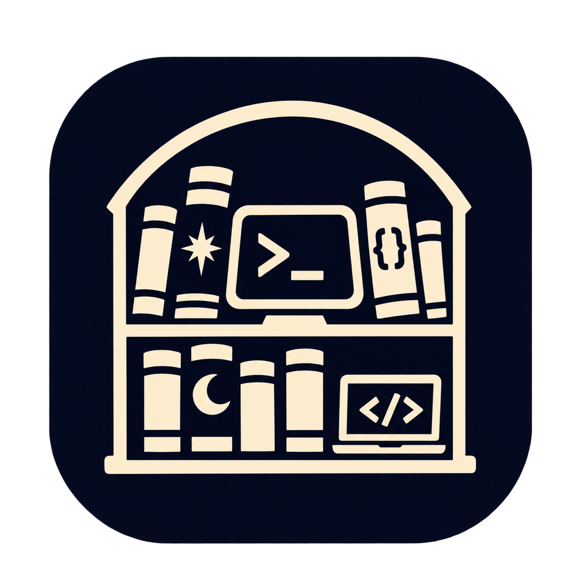
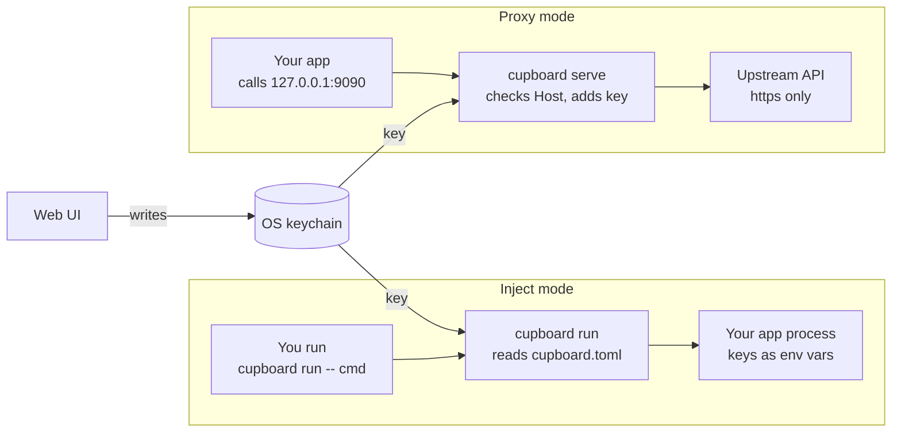

<p align="center">
  
</p>

<h1 align="center">API Cupboard</h1>

<p align="center">
  A local API cupboard for your laptop.<br>
  Store your API keys once. Use them in every project. Keep them out of your repos.
</p>

<p align="center">
  
  
  
</p>

---

> **Status:** In development. The commands and features below are the planned design for `v1.0.0`. See [`docs/project-plan.md`](docs/project-plan.md).

## Why

You copy the same OpenAI, Stripe or GitHub keys into `.env` files in many projects. Each copy is a chance to commit a secret by mistake. When a key changes, you must update every copy.

API Cupboard keeps each key in one place: your OS keychain. Your projects get the keys only when they run.

## Features

- **One store for all keys.** Keys stay in Windows Credential Manager or Linux Secret Service, not in plaintext files.
- **Inject mode.** `cupboard run -- <command>` starts your command with the keys as environment variables.
- **Proxy mode.** Your app calls `127.0.0.1:9090/<shelf>/...`. The proxy adds the key and forwards the request. Your app never sees the key.
- **Streaming support.** Server-sent events (for example, LLM streaming) pass through the proxy.
- **Web UI.** Add, edit and delete keys, and see a log of recent requests. One click on the desktop icon opens it in your browser.
- **Single binary.** Written in Go. No runtime to install.
- **Local only.** No account, no cloud, no telemetry.

## How it works



## Quick start (planned)

### 1. Add a key

```sh
cupboard add openai
# Prompts for the key and the upstream URL, for example https://api.openai.com
```

### 2a. Use inject mode

Add a `cupboard.toml` file to your project. It contains no secrets, so you can commit it.

```toml
[env]
OPENAI_API_KEY = "openai"
STRIPE_SECRET_KEY = "stripe"
```

Run your project through the cupboard:

```sh
cupboard run -- npm run dev
```

### 2b. Use proxy mode

Start the proxy:

```sh
cupboard serve
```

Point your SDK at the cupboard. Most SDKs need a key value, so give a dummy value:

```python
from openai import OpenAI

client = OpenAI(base_url="http://127.0.0.1:9090/openai/v1", api_key="unused")
```

### 3. Open the UI

Click the API Cupboard icon. If the cupboard is not running, the icon starts it. Then it opens the UI in your browser.

## Commands (planned)

| Command | Description |
| --- | --- |
| `cupboard add <shelf>` | Add a key and its upstream settings |
| `cupboard list` | Show all shelves (never shows key values) |
| `cupboard remove <shelf>` | Delete a shelf and its key |
| `cupboard run -- <cmd>` | Run a command with keys as env vars |
| `cupboard serve` | Start the proxy and the web UI |

## Security

- Keys are stored in the OS keychain.
- The proxy and UI listen only on `127.0.0.1`.
- The proxy rejects unknown `Host` headers and browser requests, to stop DNS rebinding and malicious websites.
- The UI needs a session token, and a change to an upstream URL needs a confirm step.
- Keys go only to `https://` upstreams and never appear in logs.

**Known limit:** any program that runs as your user account can call the proxy or `cupboard run`. API Cupboard protects your keys from your repos, logs and network. It does not protect them from malware on your machine.

To report a vulnerability, read [`SECURITY.md`](SECURITY.md).

## Platform notes

- **Windows 11:** a shortcut with the icon goes on the desktop and in the Start menu.
- **Linux:** a `.desktop` file puts the icon in your app launcher. A Secret Service provider (`gnome-keyring` or `kwallet`) must be running.

## Out of scope

Tray app, key rotation, rate limits, signed-request APIs (AWS SigV4, HMAC), macOS support and sync between machines.

## Contributing

Read [`CONTRIBUTING.md`](CONTRIBUTING.md).

## License

[MIT](LICENSE) © 2026 PulseEngine
