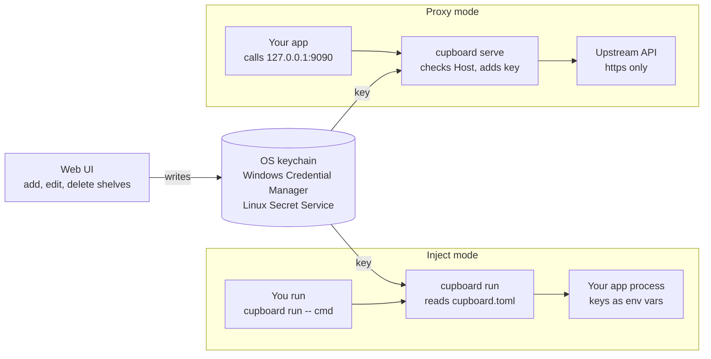

# API Cupboard: Project Plan

## 1. Goal and scope

API Cupboard is one place on your laptop for all API keys. Projects get keys at run time and never store them. Target: a finished, documented PulseEngine repo in about 4 weeks.

The tool has two modes:

- **Inject mode:** `cupboard run -- <command>` starts the command with the keys as environment variables.
- **Proxy mode:** the app sends requests to `127.0.0.1:9090/<shelf>/...`. The proxy adds the key and forwards the request. The app never sees the key.

### In scope

- Key storage in the OS keychain (Windows and Linux)
- CLI: `add`, `list`, `remove`, `run`, `serve`
- Per-project `cupboard.toml` that maps env var names to shelves
- Reverse proxy with header and query injection, and SSE streaming
- Web UI, embedded in the binary, to add, edit and delete shelves
- Request log in the UI (method, path, status, latency; no secrets)
- Desktop launcher icon that opens the UI in the browser

### Out of scope

- System tray app and native window
- Rate limiting and key rotation features
- Signed-request APIs (AWS SigV4, HMAC)
- macOS support
- Sync between machines

---

## 2. Architecture

One Go binary. Both modes read keys from the OS keychain. The UI writes keys to the keychain and shelf settings to `shelves.json`.



In inject mode, the app holds the key in memory. In proxy mode, the app never holds it.

---

## 3. UI and launcher

The UI is a web page built into the binary. It opens in your default browser. There is no tray icon and no native window.

**UI contents:**

- Table of shelves
- Form to add or edit a shelf
- Request log
- "Quit" button to stop the background process

**Launcher behavior (one click):**

1. If `cupboard serve` is not running, start it in the background.
2. Open `http://127.0.0.1:9090` in the default browser, with the session token in the URL.
3. If it is already running, only open the browser tab.

**Per platform:**

| Platform | Launcher | Open browser with |
| --- | --- | --- |
| Windows | Desktop and Start menu shortcut with custom icon | `rundll32 url.dll,FileProtocolHandler` |
| Linux | `.desktop` file in the app launcher (rofi, wofi), or a key bind | `xdg-open` |

---

## 4. Security requirements

These checks must pass before release. Each one gets a test.

| # | Requirement | Stops |
| --- | --- | --- |
| 1 | Store keys in the OS keychain, not in plaintext files | Other users and casual file reads |
| 2 | Bind only to `127.0.0.1` | Other devices on the network |
| 3 | Reject requests where `Host` is not `127.0.0.1:9090` or `localhost:9090` | DNS rebinding from a browser |
| 4 | Reject proxy requests that have an `Origin` header (browser calls) unless the shelf allows it | Websites that call the proxy |
| 5 | UI needs a random session token; all UI writes need it | CSRF on the UI |
| 6 | Changing a shelf's upstream URL needs a confirm step in the UI | Key sent to an attacker server |
| 7 | Upstream must be `https://` | Key sent in clear text |
| 8 | Never write secrets to logs, the request log or error messages | Leaks through logs |
| 9 | Strip incoming `Authorization` and cookie headers before injection | Header smuggling |
| 10 | Shelf names: `[a-z0-9-]` only | Path traversal |

**Known limit:** any process that runs as your user can still call the proxy or `cupboard run`. Write this in the README threat model.

---

## 5. Milestones

Four weeks, one milestone each week. Each week ends with a working, tagged build.

### Week 1: Store and inject (`v0.1.0`)

- [x] Repo setup: Go module, MIT license, CI for Windows and Linux
- [x] `internal/store`: save, read, delete keys in the keychain (the keychain cannot be listed, so `list` reads `shelves.json`)
- [x] `shelves.json` read and write, shelf name validation
- [ ] CLI: `add`, `list`, `remove`
- [ ] `cupboard run`: read `cupboard.toml`, start the command with env vars
- [ ] Tests for store and inject

### Week 2: Proxy (`v0.2.0`)

- [ ] `cupboard serve` on `127.0.0.1:9090`
- [ ] Route `/<shelf>/...` to the upstream URL
- [ ] Header injection (`Bearer`, `Basic`, custom) and query injection
- [ ] SSE streaming with `FlushInterval: -1`; test with the OpenAI SDK
- [ ] Security checks 2, 3, 4, 7, 9, 10 with tests

### Week 3: UI, log and launcher (`v0.3.0`)

- [ ] Embedded UI: shelf table, add/edit form, Quit button
- [ ] Session token, confirm step for upstream URL changes (checks 5, 6)
- [ ] Request log: last 200 requests, no secrets (check 8)
- [ ] Launcher: start-if-not-running, then open the browser
- [ ] Windows shortcut with icon and Linux `.desktop` file

### Week 4: Release (`v1.0.0`)

- [ ] `examples/` Node and Python apps
- [ ] README, demo GIF, `docs/threat-model.md`
- [ ] GoReleaser binaries on GitHub Releases
- [ ] Test on a clean Windows 11 install and on Arch Linux
- [ ] Go through the definition of done, then mark the repo complete

---

## 6. Tech stack and repository layout

| Part | Choice |
| --- | --- |
| Language | Go (stdlib first) |
| Keychain | `github.com/zalando/go-keyring` |
| Config | TOML (`github.com/BurntSushi/toml`) or JSON (stdlib) |
| Proxy | `net/http/httputil.ReverseProxy`, `FlushInterval: -1` for SSE |
| UI | Vanilla HTML, CSS, JS through `//go:embed` |
| CI | GitHub Actions: `go test`, `go vet`, builds for Windows and Linux |
| Release | GoReleaser, `.exe` and Linux binary |
| License | MIT |

```text
api-cupboard/
├── cmd/cupboard/main.go      # CLI entry
├── internal/
│   ├── store/                # keychain + shelf metadata
│   ├── inject/               # cupboard run
│   ├── proxy/                # reverse proxy + guards
│   ├── ui/                   # HTTP handlers, session token
│   ├── launcher/             # start-if-needed, open browser
│   └── reqlog/               # in-memory request log
├── web/                      # embedded UI files
├── assets/                   # icon, .desktop file
├── docs/threat-model.md
├── examples/                 # node, python demo apps
└── README.md
```

Shelf metadata (name, upstream URL, injection rule) lives in `~/.config/api-cupboard/shelves.json` (Linux) or `%APPDATA%\api-cupboard\shelves.json` (Windows). Secrets live only in the keychain.

---

## 7. Definition of done

When all items are ticked, tag `v1.0.0` and mark the repo as complete.

- [ ] `cupboard add`, `list`, `remove`, `run`, `serve` work on Windows 11 and Arch Linux
- [ ] Launcher icon opens the UI in the browser on both platforms
- [ ] Proxy works with the OpenAI SDK (Python and Node), including streaming
- [ ] All 10 security requirements have passing tests
- [ ] CI is green on Windows and Linux
- [ ] Release binaries are on GitHub Releases
- [ ] README has: one-line pitch, demo GIF, install, quick start, both modes, threat model link
- [ ] `docs/threat-model.md` lists what the tool protects against and what it does not
- [ ] `examples/` has one working Node app and one Python app
- [ ] No open issue marked `bug`

---

## 8. Risks and cuts

| Risk | Fallback |
| --- | --- |
| Linux keychain is not available (no Secret Service running, for example on a bare Hyprland setup) | Detect it, show a clear error, document `gnome-keyring` or `kwallet` setup |
| SSE streaming breaks through the proxy | Test it in week 2, not at the end |
| Scope grows (tray, rotation, rate limits) | Put each idea in a `v2-ideas` issue, do not build it |
| UI takes too long | Keep it to one page with a table and one form |

If time runs out, cut in this order:

1. Request log
2. Web UI and launcher (CLI only is still a complete tool)
3. Query-parameter injection (keep header injection only)

Never cut the security requirements or the tests.
